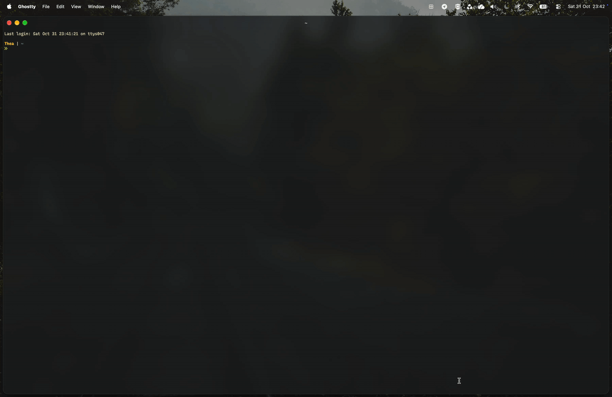

# hyprMac (Prototype)

Hyprland-style tiling for macOS that keeps your native Spaces.

Windows tile as you open them. hyprMac works with the Desktops you already have in Mission Control. It doesn't replace them with virtual workspaces, and it doesn't need System Integrity Protection turned off.

The layout engine is C++20 behind a C API, the macOS layer is Swift, and the config is sandboxed Lua.



## Features
- **Tiling.** A new window splits the focused tile along its longer side and takes the second half.
- **Gaps.** 8 pt between tiles, 12 pt at the screen edges (menu bar and Dock excluded).
- **Native Spaces.** ⌥1–⌥9 are still macOS's own "Switch to Desktop N". hyprMac only listens, so it can tell you when a Desktop doesn't exist.
- **Throwing windows.** ⌥⇧1–⌥⇧9 move the focused window to Desktop N. macOS has no public API for that, so hyprMac uses a drag trick. See [limitations](docs/LIMITATIONS.md#moving-windows-between-spaces).
- **Navigate.** ⌥⇧H/J/K/L (or arrows) move focus, ⌥⇧⌘H/J/K/L move the window, ⌥⇧C centers it, ⌥⇧F floats or tiles it.
- **Same spot back.** Fullscreen, minimized or hidden windows return to their tile.
- **Per display.** Each display tiles from its own active Space.
- **Floating.** Dialogs, sheets, panels and popovers are never tiled. Small windows float, like in Krohnkite, and so do non-resizable windows, Archive Utility and Calculator. A window that keeps resizing itself away from its tile is floated instead of fought.
- **Resize by hand.** Drag a tile's edge and the split follows. See [usage](docs/USAGE.md#resizing-by-hand).

## Requirements
- macOS 14 or later. Tested on macOS 27.2, Apple silicon.
- Command Line Tools (`xcode-select --install`). Full Xcode isn't needed.
- **Displays have separate Spaces** is on (System Settings ▸ Desktop & Dock). It's the default.
- **Stage Manager is off.** `make install` turns it off, but macOS only applies that after you toggle it in Control Center or log out. While it's on, hyprMac pauses.
- **⌥1–⌥9 are bound** to "Switch to Desktop N" (Keyboard Shortcuts ▸ Mission Control). `make install` adds ⌥8 and ⌥9 if they're free. Set ⌥1–⌥7 yourself.

## Quick start
```sh
git clone https://github.com/Codesmith28/hyprMac.git && cd hyprMac
make            # build the core and build/hyprMac.app
make test       # tests that need no permissions
make install    # install to ~/Applications and start at login
make uninstall  # undo everything install did
```

`make preflight` shows what install would change. `DRY_RUN=1` on install or uninstall prints the commands without running them.

After install, System Settings opens to Privacy & Security ▸ Accessibility. Turn hyprMac on, and tiling starts within a second. To try it without installing, run `make run`.

## What install changes
`make install` saves every change, and the original value, in a manifest under `~/Library/Application Support/hyprMac/install/`. `make uninstall` replays that in reverse. Then it takes a fresh snapshot and compares it with the one from before install. Any difference is printed, and uninstall exits with 1.

- **Shortcuts.** Adds ⌥8 and ⌥9 ("Switch to Desktop 8/9") only if they're unbound. Existing bindings are never touched.
- **Stage Manager.** Sets `GloballyEnabled` to false, reads it back, and restores the old value on uninstall.
- **App.** Copies `hyprMac.app` to `~/Applications/`. An existing copy is moved aside and put back on uninstall.
- **Config.** Creates `~/.config/hyprmac/init.lua` if that folder doesn't exist. Uninstall removes it only if install created it. Keep it with `KEEP_CONFIG=1 make uninstall`.
- **Login item.** Writes `~/Library/LaunchAgents/dev.codesmith28.hyprmac.plist`.
- **Accessibility.** Resets hyprMac's entry, so the new signature starts clean.
- **App data.** Backs up existing preferences, caches and notification settings. Uninstall removes hyprMac's data and restores the backups.

Notes:
- If any install step fails, everything done so far is rolled back.
- Running `make install` again upgrades. It replaces the app and reloads the agent, and keeps the original values.
- `make verify-rollback` compares the current state with the pre-install snapshot. Blind spots are listed in [limitations](docs/LIMITATIONS.md#what-verify-rollback-cannot-see).
- You can uninstall without the repo: `~/Applications/hyprMac.app/Contents/Resources/scripts/uninstall.sh`.

## Configuration
hyprMac reads `~/.config/hyprmac/init.lua`. Every key is optional, and with no file you get the defaults.

```lua
config = {
    gaps = {
        inner = 8,   -- points between adjacent windows      (0 – 200)
        outer = 12,  -- points between windows and the edges (0 – 200)
    },
    split_ratio = 0.5, -- share of a split given to the existing window (0.1 – 0.9)
    float = { min_width = 400, min_height = 300 }, -- smaller windows float (0 – 2000, 0 = off)
    osd_popup = true,  -- brief on-screen popup on window and Desktop actions
    keys = {           -- shortcuts (defaults shown)
        throw = "alt+shift", toggle_float = "alt+shift+f", switch = "alt",
        center_window = "alt+shift+c",
        focus_left = "alt+shift+h", focus_down = "alt+shift+j", focus_up = "alt+shift+k", focus_right = "alt+shift+l",
        move_left = "alt+shift+cmd+h", move_down = "alt+shift+cmd+j", move_up = "alt+shift+cmd+k", move_right = "alt+shift+cmd+l",
    },
    rules = { ignore = {}, float = {} },           -- bundle ids: never managed / always floating
}
```

- Reload from the menu (**Reload Configuration**) or with `pkill -HUP -x hyprMac`.
- A file with an error is rejected as a whole. hyprMac keeps the old settings and tells you the file, line and problem.
- The schema is strict. Unknown keys and wrong types are errors. The Lua sandbox has no `io`, `os`, `require` or `load`, and it has memory and instruction limits.

The shortcut grammar and app rules are in [usage](docs/USAGE.md#keys-and-app-rules).

## Architecture
```
HyprApp (Swift)           menu bar, onboarding, notifications
  └ HyprKit (Swift)       coordinator: one serial queue
      ├ HyprPlatform      Accessibility, Spaces, hotkeys, window writes
      └ hyprcore (C++20)  BSP layout, gaps, Lua config
                          C API: core/include/hypr/hypr_core.h
```

A window event schedules a reconcile. The engine compares the Space's layout with the current windows and returns target frames. The frames are written through Accessibility, with one queue per app, so a hung app can't stall the others.

Design details are in [architecture](docs/ARCHITECTURE.md). The macOS behaviour I checked on a real Mac is in [quirks](docs/QUIRKS.md).

## How it compares
yabai gives full control of Spaces but needs SIP partly off. Amethyst keeps native Spaces with no SIP changes, but its layouts are fixed. AeroSpace uses its own workspaces, so Mission Control doesn't match them.

hyprMac keeps native Spaces and needs no SIP changes. It can't create or delete Spaces, and a throw takes about half a second.

## Make targets
`make help` lists them all. The main ones:

| Target | What it does |
|---|---|
| `make` | build the core and `build/hyprMac.app` |
| `make run` | run the app from `build/` in the foreground |
| `make test` | tests that need no permissions |
| `make test-e2e` | real-Mac end-to-end suite (needs Accessibility; see [testing](docs/TESTING.md)) |
| `make preflight` | show what install would change, without changing anything |
| `make install` / `make uninstall` | install or remove, reversibly (`DRY_RUN=1` to only print) |
| `make verify-rollback` | compare the current state with the pre-install snapshot |
| `make bench` | latency benchmark of the core |
| `make clean` | remove build products |

## Documentation
- [usage](docs/USAGE.md): shortcuts, the menu, notifications, troubleshooting
- [limitations](docs/LIMITATIONS.md): what macOS makes impossible or fragile, and how hyprMac copes
- [testing](docs/TESTING.md): the test layers and the end-to-end runbook
- [architecture](docs/ARCHITECTURE.md) and [quirks](docs/QUIRKS.md): design notes and verified macOS behaviour
